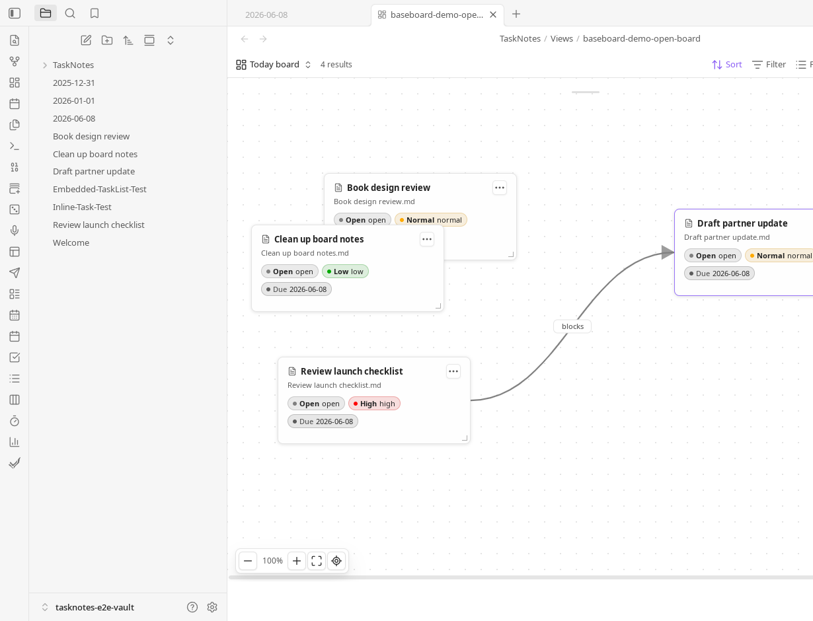

# Canvas Bases

Canvas Bases is an Obsidian plugin for Bases and Canvas, and a companion plugin for TaskNotes.
It turns a live Obsidian Bases view into a canvas-style working board. Bases
still owns the query: filters, sorting, grouping, and visible properties stay in
the `.base` file. Canvas Bases adds spatial layout, cards, groups, relationship
edges, assignment zones, and JSON Canvas export on top of that result set.


## What It Does

- Adds a **Canvas Bases** layout to Obsidian Bases.
- Shows Base rows as draggable, resizable file cards on a board.
- Uses Base grouping as board frames, while ungrouped views place cards directly
  on the canvas.
- Persists board geometry, colors, manual cards, groups, zones, and linked
  Canvas options in Canvas Bases-owned view config keys.
- Creates or updates `.canvas` snapshots from the active Bases view, including
  native and third-party Bases layouts.
- Preserves manual Canvas nodes and edges that Canvas Bases does not own when
  updating a generated Canvas.
- Integrates with TaskNotes when available, while degrading cleanly when it is
  absent.

## Screenshots

Canvas Bases layout embedded in a daily note:


Dragging a link from one card to another:


Rendered relationship edge on the board:



## Requirements

- Obsidian 1.10.1 or newer.
- Obsidian Bases.
- Obsidian Canvas when opening or editing generated `.canvas` files.
- TaskNotes is optional. TaskNotes badges, task menus, task relationship edges,
  and task zone actions are skipped when TaskNotes is unavailable or does not
  expose the required API capability.
- mdbase is optional. When its local interoperability grant is enabled, Canvas
  Bases provides the `canvas.card.create` action contract and publishes the
  `canvas.drop` event contract to other plugins.

## Using The Canvas Bases Layout

Open a `.base` file, add a view, and set its layout to **Canvas Bases**.
Configure the query with normal Bases controls, then use Canvas Bases for the
spatial layer.

The board supports:

- Dragging and resizing file cards, group frames, text cards, and manual groups.
- Background panning, zooming from 10% to 200%, fit view, and reset view.
- Inline Markdown body editing on file cards when **Show body editor** is
  enabled. Edits are debounced and saved back to the note.
- Card colors that carry into generated Canvas nodes.
- Pinned notes that stay on the board even when they are not in the Base result.
- Text cards for board-local notes.
- Marquee selection for creating manual groups or custom assignment zones.
- Double-clicking file cards to open the underlying note.

The toolbar can pin notes, add text cards, add manual groups, add assignment
zones, create or update the linked Canvas, open the linked Canvas, and reset
stored layout positions.

## Assignment Zones

Assignment zones are board frames that run a drop action when a note card is
dropped into them.

Bases-derived zones update the Base group property. Custom zones can be created
from the toolbar or from a marquee selection and can write a different
property. Property zones can replace, append, append uniquely, remove, or clear
values, with automatic or explicit text, number, boolean, date, and list value
handling.

With TaskNotes available, custom zones can also complete or uncomplete tasks,
archive or unarchive tasks, start or stop time tracking, start or assign a
Pomodoro, and complete or skip a recurring occurrence.

## Creating Canvas Snapshots

Canvas Bases can create a JSON Canvas from either the Canvas Bases layout or any
active native or third-party Bases layout.

Run:

```text
Canvas Bases: Create canvas from current bases view
```

The modal lets you choose the Canvas path, layout, edge source, TaskNotes
relationship edges, node size, and update rules. Saved options are reused by:

```text
Canvas Bases: Update linked canvas
Canvas Bases: Open linked canvas
```

Generated Canvas files use stable Canvas Bases-owned node and edge IDs.
Updating a Canvas can preserve existing Canvas Bases positions, remove Canvas
Bases-owned nodes that no longer appear in the Base result, and keep unrelated
manual Canvas content intact.

The generated `.canvas` file is a snapshot, not a live query. Update it again
after changing the Base result set or board layout.

## Edges And Links

Canvas Bases renders live board edges and writes Canvas edges when both endpoint
notes are present on the board.

Edge sources:

- `none`
- `wikilinks`: links found in notes in the current view
- `properties`: links from configured note properties
- `all`: wikilinks and configured note properties

Property edge names are configured as a comma-separated list, for example:

```text
depends_on, related
```

Dragging from a card's link handle to another card opens a relationship menu.
Canvas Bases can create configured frontmatter property links, and when
TaskNotes is available it can also create supported dependency or subtask relationships.
Existing removable property and TaskNotes relationships can be removed from the
edge context menu.

## TaskNotes Integration

TaskNotes support is optional and capability-based. When available, Canvas Bases
can show TaskNotes status, priority, due date, blocker, recurrence, time
estimate, tracked-time, and active-tracking badges on cards. It can also use
TaskNotes task menus from card actions and render dependency or subtask edges on
the live board and generated Canvas.

If TaskNotes is disabled, absent, or missing a capability, Canvas Bases keeps the
Bases and Canvas workflows working without TaskNotes-only behavior.

## mdbase Interoperability

With the mdbase plugin installed and **Allow local application
interoperability** enabled, Canvas Bases registers one action provider:

```text
canvas.card.create@1.0.0
```

The action appends a text or file card to a selected `.canvas` file and returns
the created card ID. Its input and output are defined by an mdbase action
contract using JSON Schema. Callers can require the exact provider application
`canvas-bases`; provider ambiguity and incompatible versions fail explicitly.

The provider is optional and does not change normal Canvas Bases behavior.

Canvas Bases also declares `canvas.drop@1.0.0` as an event source. Dropping a
file card into an active group publishes a CloudEvent containing the board,
record, position, target group, and whether the group assignment changed.
Events are multicast, so every granted compatible subscriber receives its own
copy. Contract compatibility does not grant access; the mdbase interoperability
grant remains the authorization boundary.

## Commands

```text
Canvas Bases: Create canvas from current bases view
Canvas Bases: Update linked canvas
Canvas Bases: Open linked canvas
Canvas Bases: Create starter files
```
