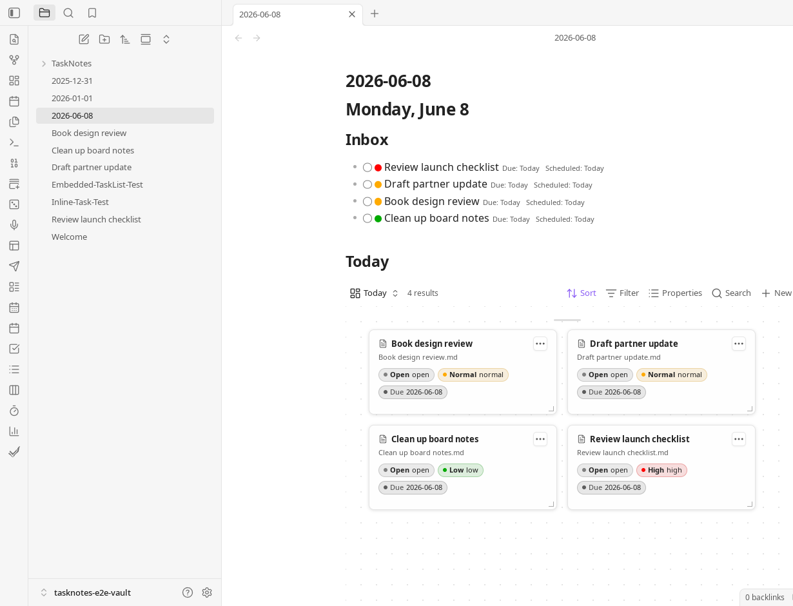
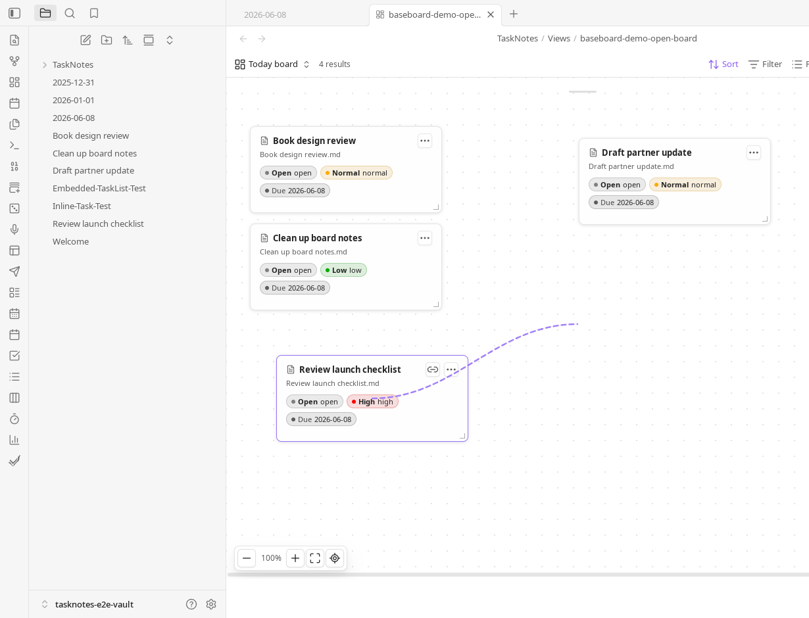

# Baseboard

Baseboard is an Obsidian plugin for Bases and Canvas.

It adds a Bases layout named **Baseboard** and commands that create or update a
JSON Canvas file from the active Bases view. Bases remains the source for
queries, filters, sorting, grouping, and displayed properties. The generated
`.canvas` file is a snapshot that can be updated from the current view.


## Screenshots

Baseboard layout embedded in a daily note:



Dragging a link from one card to another:



Rendered relationship edge on the board:


## Requirements

- Obsidian 1.10.1 or newer.
- The Obsidian Bases core plugin.
- The Obsidian Canvas core plugin when opening or editing generated `.canvas`
  files.
- TaskNotes is optional. TaskNotes-specific badges, actions, and relationship
  edges are skipped when TaskNotes is not available or does not expose the
  required runtime capability.

## Workflows

### Baseboard Bases Layout

1. Open or create a `.base` file.
2. Add a view and set its layout to **Baseboard**.
3. Configure the Base filters, sort order, grouping, and displayed properties.
4. Use the Baseboard toolbar to create, update, open, or reset the linked
   canvas.

In this layout, Base rows are shown as file cards on a canvas-like surface. Base
groups become group frames. The Base sort order is used when cards are first
placed.

Cards and groups can be dragged and resized. Manual group frames can also be
created, renamed, and removed without changing the underlying Base query.
Coordinates and dimensions are stored in the `.base` view config. The same
stored geometry is used when the linked `.canvas` file is created or updated.

### Materialize Any Active Bases View

Baseboard also works from native and third-party Bases layouts. Open a Bases
view and run:

```text
Baseboard: Create canvas from current bases view
```

The command opens a modal for the canvas path, layout, edge mode, node size, and
update rules. Saved options are reused by:

```text
Baseboard: Update linked canvas
Baseboard: Open linked canvas
```

Options for non-Baseboard views are stored in Baseboard plugin data. Options for
the Baseboard layout are stored in the `.base` view config.

## Board Behavior

- Each Base result row becomes a file card.
- Base groups become group frames.
- Displayed Base properties are shown on cards in the same order as the Base
  properties menu.
- Inline note-body editing is available when **Show body editor** is enabled.
  Edits are debounced and saved back to the Markdown file.
- The board supports background panning, zoom in/out, fit view, reset view,
  dragging, resizing, and double-click-to-open on file cards.
- Notes can be pinned manually to the board even when they are not in the
  current Base result.
- Text cards and manual groups can be added to a Baseboard view. Manual groups
  behave like Canvas group frames: removing the frame does not remove the cards.
- Manual notes, manual groups, text cards, and stored geometry are written to
  Baseboard-owned keys in the `.base` view config.

## Edges

Baseboard can render and materialize edges when both endpoint notes are present
on the board.

Edge sources:

- `none`
- `wikilinks`: links found in notes in the current view
- `properties`: links from configured note properties
- `all`: wikilinks and configured note properties

Property edge names are configured as a comma-separated list, for example:

```text
depends_on, related
```

When TaskNotes integration is enabled, Baseboard can also add TaskNotes
dependency edges, or dependency and subtask edges. Dragging from the link handle
on one file card to another opens a menu for supported TaskNotes relationships
and configured property links.

Existing relationship edges can be opened from their context menu. Removable
TaskNotes and property relationships can also be removed from that menu.

## Canvas Updates

Generated canvases use stable Baseboard-owned node and edge IDs. This lets
Baseboard update an existing `.canvas` file without replacing unrelated manual
items.

Update behavior:

- Existing non-Baseboard canvas nodes and edges are preserved.
- Existing Baseboard card positions can be preserved.
- Baseboard-owned nodes missing from the current Base result can be removed when
  **Remove missing notes** is enabled.
- Baseboard layout choices are `columns`, `rows`, and `grid`.
- The Baseboard layout uses the current live board geometry when updating its
  linked canvas.

The `.canvas` file is not a live query. Re-run **Update linked canvas** after
changing the Base result set or board layout.

## Baseboard View Config Keys

These keys are written only for Baseboard behavior:

| Key | Purpose |
| --- | --- |
| `baseboardCanvasPath` | Linked `.canvas` path. |
| `baseboardLayout` | Initial materialization layout: `columns`, `rows`, or `grid`. |
| `baseboardEdgeMode` | Edge source: `none`, `wikilinks`, `properties`, or `all`. |
| `baseboardEdgeProperties` | Comma-separated property names used for property edges. |
| `baseboardShowBodyEditor` | Shows editable note bodies on file cards. |
| `baseboardTaskNotesMode` | TaskNotes integration mode: `auto` or `off`. |
| `baseboardTaskNotesShowBadges` | Shows TaskNotes badges on file cards. |
| `baseboardTaskNotesShowActions` | Uses TaskNotes actions in card menus when available. |
| `baseboardTaskNotesRelationships` | TaskNotes edge mode: `none`, `dependencies`, or `all`. |
| `baseboardPreservePositions` | Keeps existing Baseboard node positions when updating a canvas. |
| `baseboardRemoveMissingNodes` | Removes Baseboard-owned nodes no longer in the Base result. |
| `baseboardNodeWidth` | Default width for file cards. |
| `baseboardNodeHeight` | Default height for file cards. |
| `baseboardNodePositions` | Stored card and group geometry for the live board. |
| `baseboardManualNotePaths` | Notes manually pinned to the board. |
| `baseboardManualGroups` | Manual group frames. |
| `baseboardTextCards` | Manual text cards. |

## Development

Install dependencies:

```bash
npm install
```

Run checks:

```bash
npm run lint
npm test
npm run typecheck
```

Build the plugin:

```bash
npm run build
```

Build and copy the plugin into the configured test vaults:

```bash
npm run build:test
```

Reload Baseboard in a running Obsidian test vault:

```bash
obsidian vault=test plugin:reload id=baseboard
```

For code or CSS changes, run `npm run build:test` and reload the plugin before
manual verification.

## Demo Media

The README GIF and static screenshots are stored in:

```text
media/readme/
```

The local source captures used to create these files are under the following
paths in this checkout. They are not required to use the plugin.

```text
media/baseboard-release-video/
media/baseboard-demo/
```
